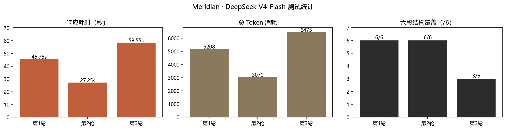

# Meridian · 中文行业研究报告 Agent

Meridian 是一套面向中文行业研究的自动化深度报告生成系统。以"子午线"为名，取"贯通中外信息边界、建立完整研究视野"之意。系统基于开源项目 [gpt-researcher](https://github.com/assafelovic/gpt-researcher)（v0.14.7）二次开发，以 LangGraph 多智能体编排为核心，输入一个研究主题，输出带来源引用、事实核查、结构化章节的中文学术风格研究报告。

## 架构

系统采用双主线 + 四层复用设计，稳定性优先：

```
Layer 4 · 交互层   FastAPI 服务 + 轻量中文界面（backend/meridian_ui.py）
Layer 3 · 编排层   LangGraph 多智能体图（默认主线）
                   browser → planner → human → researcher×n → writer
                   → fact_checker(回环) → visualizer → publisher
                   降级路径：单 Agent 流水线（GPTResearcher）
Layer 2 · 知识层   博查中文检索（bocha）+ 本地文档 RAG（向量库）
Layer 1 · 模型层   DeepSeek（deepseek-chat / deepseek-reasoner）
```

多智能体图含规划阶段人工介入节点（human-in-the-loop）与事实核查回环（fact_checker → writer），核查意见为空视为通过，修订超上限强制放行，避免死循环。

## 核心能力

- 多智能体深度研究：LangGraph 编排"初始检索 → 章节规划 → 人工审核 → 并行深度研究 → 写作 → 事实核查 → 发布"全链路
- 中文信息获取：博查中文检索 + 行业域名限定（query_domains）+ 本地知识库 RAG（支持 pdf/docx/pptx/csv/xlsx/md 等 11 种格式，切分参数配置驱动）
- 中文学术报告：meridian_report 报告类型（摘要 / 背景与方法 / 数据与发现 / 结论 / 风险与局限 / 参考文献），Markdown 为主，可导出多格式
- 双主线降级：多智能体链路异常时自动回退单 Agent 流水线，保证任何情况下可交付报告

## 测试结果

测试于本地隔离环境执行，覆盖模块冒烟、图编译、路由逻辑与 LLM 端到端生成，LLM 环节调用 DeepSeek V4-Flash 真实生成中文研究报告：

| 测试项 | 结果 |
|---|---|
| 模块冒烟测试 | 15 / 15 通过（编排、检索器、文档、向量库、报告类型、界面） |
| LangGraph 图编译 | 通过，9 节点（browser / planner / human / researcher / writer / fact_checker / visualizer / publisher / end） |
| 路由逻辑 | 4 场景通过（核查接受 / 打回重写 / 超限放行 / None 字符串） |
| LLM 端到端（V4-Flash） | 三轮实测：2 轮完整覆盖六段结构（摘要 / 背景与方法 / 数据与发现 / 结论 / 风险与局限 / 参考文献），单轮耗时 27–59 s |
| 工程发现 | V4-Flash 为推理型模型（约 84% 输出为推理 Token），生成长报告建议 max_tokens ≥ 6000，避免正文被推理预算挤空 |

测试统计（DeepSeek V4-Flash 三轮实测：响应耗时 / Token 消耗 / 六段结构覆盖）：



## 快速开始

要求 Python >= 3.11（推荐 3.12）。

```bash
git clone https://github.com/Chluto/Meridian.git
cd Meridian
python -m venv .venv
.venv\Scripts\activate            # Windows
pip install -r requirements.txt
```

配置（`.env`）：

```env
OPENAI_BASE_URL=https://api.deepseek.com
DEEPSEEK_API_KEY=sk-xxx           # https://platform.deepseek.com
FAST_LLM=openai:deepseek-chat
SMART_LLM=openai:deepseek-chat
STRATEGIC_LLM=openai:deepseek-reasoner
BOCHA_API_KEY=sk-xxx              # https://open.bochaai.com（中文检索）
RETRIEVER=bocha,tavily
DOC_PATH=./my-docs                # 本地知识库目录（可选）
```

运行：

```bash
# 单 Agent 中文研究报告（meridian_report 类型）
python -m backend.meridian_ui     # 轻量中文界面，http://localhost:8010

# LangGraph 多智能体深度研究
python multi_agents/main.py       # 编辑 task.json 设置研究主题
```

## 配置项说明

| 配置 | 说明 |
|---|---|
| `FAST_LLM / SMART_LLM / STRATEGIC_LLM` | 三档模型，`provider:model` 格式；DeepSeek 经 `openai:` 前缀 + `OPENAI_BASE_URL` 注入，agent 代码零侵入 |
| `RETRIEVER` | 检索器列表（逗号分隔），可叠加多源 |
| `CHUNK_SIZE / CHUNK_OVERLAP` | RAG 切分参数（默认 1000 / 200），中文长文档可调 |
| `EMBEDDING` | 向量化模型；DeepSeek 平台不提供 embedding，需单独配置 OpenAI / SiliconFlow / Ollama 等服务 |

## 项目结构

```
meridian/
├── multi_agents/                    # LangGraph 多智能体编排（核心）
│   ├── agents/
│   │   ├── orchestrator.py          #   图构建与条件路由（缺陷修复处）
│   │   ├── writer.py                #   中文学术写作
│   │   ├── fact_checker.py          #   事实核查回环
│   │   ├── editor.py                #   章节规划（planner）
│   │   ├── visualizer.py / publisher.py / human.py / research.py
│   └── memory/
│       └── research.py              #   ResearchState 状态定义
├── gpt_researcher/                  # 单 Agent 流水线（上游基线 · 降级路径）
│   ├── prompts.py                   #   meridian_report 中文提示词族
│   ├── config/                      #   配置解析与 .env
│   ├── retrievers/                  #   bocha / tavily 检索器
│   ├── document/                    #   本地文档加载（RAG）
│   └── vector_store/                #   向量库封装（chunk 参数化）
├── backend/
│   ├── report_type/meridian_report/ #   meridian_report 报告入口（新增）
│   ├── meridian_ui.py               #   轻量中文界面（新增）
│   └── server/                      #   WebSocket 路由注册
├── docs/                            # 文档与测试结果图
├── tests/                           # 测试
└── .env.example                     # 配置模板
```

## 二次开发声明

本项目基于 [gpt-researcher](https://github.com/assafelovic/gpt-researcher)（MIT 标注、LICENSE 文件为 Apache-2.0，以 Apache-2.0 为准）二次开发，全部改动集中在中文化、多智能体缺陷修复、报告类型扩展与配置层。原始版权归原作者所有，本仓库保留其 LICENSE 与版权声明。

## License

Apache License 2.0（与上游 LICENSE 文件一致）。
